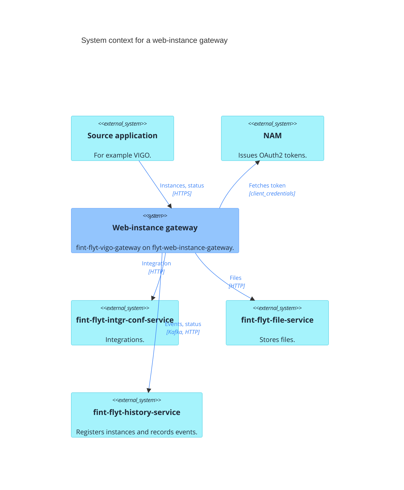
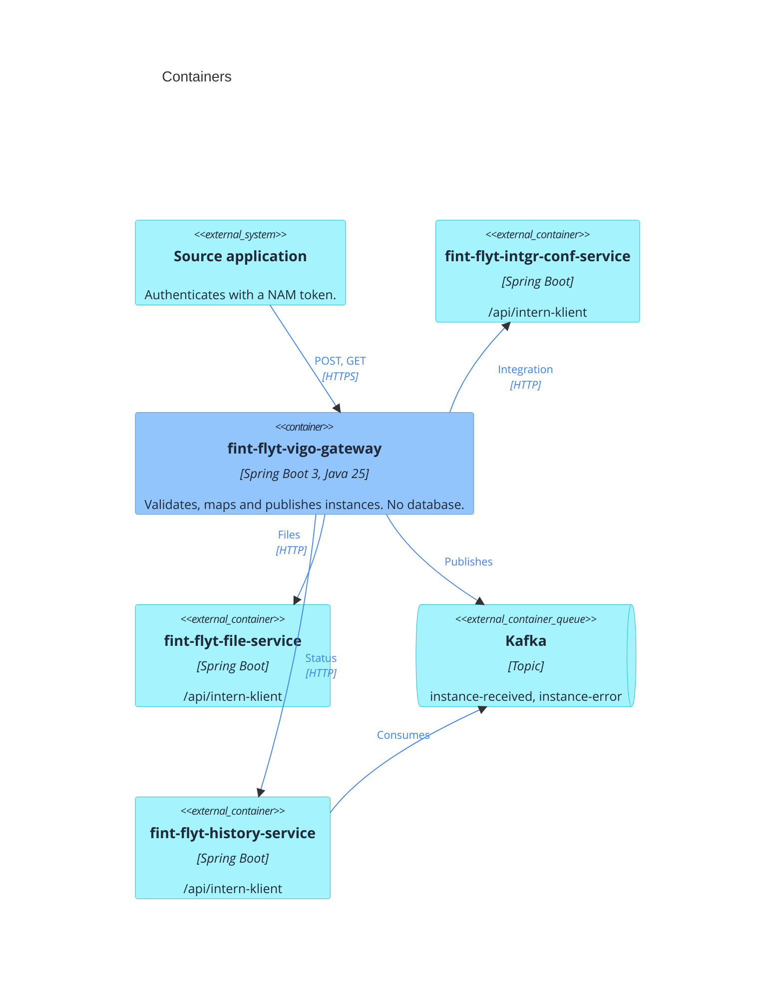
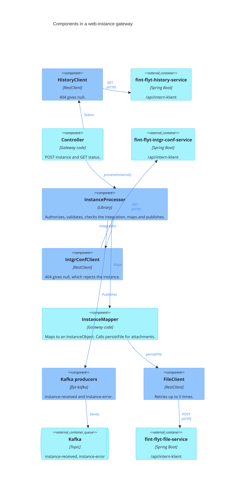

# Architecture

C4 level 1 to 3 for flyt-web-instance-gateway. It is a library, so the diagrams show it inside the gateway that uses it, fint-flyt-vigo-gateway. Blue is this library, turquoise is external.

## C4 level 1: System context

A source application sends an instance. The gateway checks the integration, stores the files and hands the instance over to history-service.

## C4 level 2: Containers

One Spring Boot application with no database. Every HTTP call to an internal API uses its own registration and a token from NAM: `file-service`, `intgr-conf-service` and `history-service`. The registrations use two OAuth clients: `fint-flyt-file-oauth2-client` for file-service, and the shared `fint-flyt-authorization-oauth2-client` for intgr-conf-service and history-service. flyt-web-resource-server uses the shared client with the registration `authorization-service` to authorize source applications.

## C4 level 3: Components

The controller and the mapper are gateway code. Everything else comes from the library.

A rejected instance (validation error, unknown or deactivated integration) gives 422, and other errors give 500. Both are published as `instance-error`. vigo-gateway answers 400 to a status request for an instance that history-service does not know.
